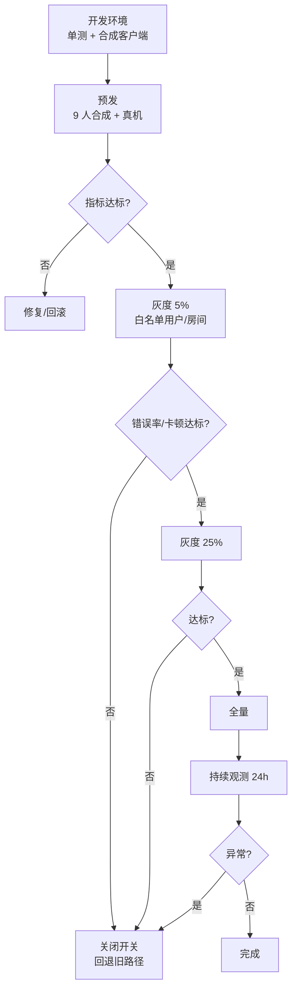

# 音视频模块 · 实施计划：契约改造、实验与风险登记

> 前置阅读：[05 现状](./05-现状评估-our-chat音视频模块差距分析.md)、[06 目标架构](./06-目标架构-统一控制面与可插拔媒体面.md)。
>
> 本篇是"可执行清单"：改哪些文件、加哪些表/指标、做什么实验、怎么灰度/回滚、风险怎么登记。
>
> 约定：任务按 P0–P3 排列；每个任务都有"验收"，没有验收的任务不算完成。

---

## 0. TL;DR

- **P0（1–2 周）**：先修安全与契约，不加新功能。核心是"四个上行事件校验参与者 + callId 随机化 + QoE 上报 + TURN 端口单点定义"。
- **P1（2–4 周）**：引入 `media` 模块与房间模型，1v1 双跑；TURN 443/双实例；容量水位与告警；信令压测。
- **P2（4–6 周）**：接 LiveKit 做群聊（3–16 人），Web + iOS；屏幕共享；录制可选。
- **P3（3–5 周）**：接 SRS 做直播 MVP，复用已有弹幕/礼物规划。
- **不做**：自研 SFU 内核、私有 UDP 协议、万人 SFU 直播、P2P Mesh 群聊。

---

## 1. P0：安全与契约（1–2 周）

### 1.1 任务清单

| # | 任务 | 改动点 | 验收 |
|---|---|---|---|
| P0-1 | 每个通话上行事件校验参与者 | `biz/internal/realtime/callRelay.go`：`call:accept/reject/end/rejoin/ice` 先 `GetCallSession`，校验 `uctx.UserID ∈ {CallerID, CalleeID}`；不匹配返回 403 | 用他人 `callId` 调 `call:end` 返回 403，会话不被清理 |
| P0-2 | `call:accept` 不信客户端 `to` | 同文件：转发目标改为 `s.CallerID` | 伪造 `to` 不会把 answer 投给第三方 |
| P0-3 | `callId` 随机化 | `web/src/hooks/useCall.ts` 生成 `call_<32 hex>`；`biz` 校验格式（`^call_[0-9a-f]{32}$`）；旧格式临时兼容并打日志 | 新通话 ID 不可枚举；旧客户端仍可用 |
| P0-4 | `call:end`/`call:ice` 读会话 | `callRelay.go:99-121`、`:164-181`：删除 `strings.Split` 解析，改用 `s.CallerID/s.CalleeID`；会话不存在返回 410 | 改 `callId` 格式不再影响挂断/ICE |
| P0-5 | 被叫校验与限流 | `call:start`：被叫存在、非自己、非黑名单、好友/群成员（按产品）；每用户呼叫频率限制（Redis 令牌桶） | 呼叫不存在用户返回错误；刷呼叫被限流 |
| P0-6 | QoE 上报最小闭环 | Web：`web/src/utils/qoeReporter.ts`（每 3s `getStats`，15s 批量 POST）；biz：`POST /api/media/quality`；Redis 近实时 + PG 样本；Prometheus 指标 | Grafana 能看到 RTT/丢包/relay 占比；样本可按 callId 查 |
| P0-7 | TURN 端口段单点定义 | `docker/coturn/turnserver.conf` 与 `docker-compose.prod.yml` 注释统一；CI 加校验脚本（解析 conf 与 compose 注释，不一致即失败） | 两处数字一致；CI 能拦住漂移 |
| P0-8 | TURN 容量水位 | 采集 allocation 数/带宽/508；Grafana 面板 + 告警 | 达到 `total-quota` 80% 告警；508 立即告警 |
| P0-9 | 信令压测脚本 | `perf/call-bench.mjs`：start/accept/end 成对循环；输出 QPS/p95/错误 | 能在本地跑出基线；报告归档 |

### 1.2 P0 的关键代码位置

```text
biz/internal/realtime/callRelay.go     ← 参与者校验、to 校验、读会话
biz/internal/service/call.go           ← 会话读写（已有，复用）
web/src/hooks/useCall.ts               ← callId 生成、QoE 触发
web/src/utils/qoeReporter.ts           ← 新增
biz/internal/api/router.go             ← /api/media/quality
biz/migrations/                        ← qoe_samples 表（若落 PG）
docker/coturn/turnserver.conf          ← 端口段/443
docker/docker-compose.prod.yml         ← 注释/端口
perf/call-bench.mjs                    ← 新增
```

> 迁移提醒：`biz/migrations` 是 **embed 进二进制**的，新增迁移后必须 `go build` 才会生效；版本号先查 `biz/migrations/` 现状。

### 1.3 P0 验收（安全）

| 测试 | 期望 |
|---|---|
| 用户 C 用 A/B 的 `callId` 发 `call:end` | 403，A/B 会话仍存在 |
| 用户 C 发 `call:ice` 注入候选 | 403，A/B 媒体不受影响 |
| 用户 B 伪造 `call:accept` 的 `to=C` | answer 只到 A |
| 枚举 `call_<a>_<b>_<ts>` | 新格式不可枚举；旧格式被拒绝/降级 |
| 呼叫不存在的 userId | 400/404，不产生会话 |
| 1 秒内发起 100 次呼叫 | 触发限流，返回明确错误 |

---

## 2. P1：1v1 硬化与房间模型（2–4 周）

### 2.1 契约与代码

| # | 任务 | 改动点 | 验收 |
|---|---|---|---|
| P1-1 | 新增 `media/v1` proto | `proto/ourchat/media/v1/media.proto`（RoomJoin/RoomJoined/RoomLeave/RoomState/TrackPublish/QualityReport）；`buf generate` 生成 Go/TS/Swift | 生成代码通过编译；契约评审通过 |
| P1-2 | `biz/internal/media` 包 | `room.go`（状态机）、`adapter.go`（接口）、`p2p.go`（1v1 适配）、`store.go`（Redis/PG） | 单测覆盖创建/加入/离开/关闭/超时 |
| P1-3 | 房间模型与 1v1 双跑 | `call:*` v1 与 `media.*` v2 双写；读以 v1 为准 | 旧客户端无感；新客户端可用 v2 |
| P1-4 | gateway 前缀路由 | `handleUplink` 增加 `media:` 分支（仍到 biz）；预留 `live:` 多上游 | `media.*` 帧能到 biz；`message/call` 不受影响 |
| P1-5 | TURN 443/双实例 | 方案见 §2.2；`iceServers` 增加 `turns:...:443` / `turn:...:443?transport=tcp` | 企业网/只放行 443 的环境可通 |
| P1-6 | ICE 失败原因上报 | 客户端记录 `ice_failure_reason`（超时/候选不足/NAT 类型）；随 QoE 上报 | 能区分"没候选/候选不通/被防火墙拦" |
| P1-7 | 容量水位与告警 | TURN allocation/带宽、SFU 预留、信令 QPS | 打满前 20% 预警 |
| P1-8 | 信令 v2 文档 | `docs/音视频模块/架构/` 更新；proto 注释 | 新人能按文档接入 |

### 2.2 TURN over 443 的现实约束

| 方案 | 做法 | 约束 |
|---|---|---|
| **TURN/TLS 443** | coturn `tls-listening-port=443` | 需要**独立 IP**（443 被 nginx 占用）；或用 SNI/ALPN 多路复用（复杂） |
| **TURN/TCP 443** | `turn:host:443?transport=tcp` | 同样需要独立 IP/端口复用 |
| **TURN/UDP 443** | coturn `--alt-listening-port=443`（UDP） | 与 TCP 443 不冲突；可先做这个 |
| **现有 5349** | `turns:host:5349` | 很多企业网只放行 443，5349 不通 |

**建议**：P1 先加 **TURN/UDP 443**（成本最低），再评估独立 IP 做 TURN/TLS 443。不要在没有独立 IP 的情况下直接改 443/TCP，会把 nginx 打挂。

### 2.3 数据模型（P1 最小集）

```sql
-- 房间
CREATE TABLE media_rooms (
  room_id     TEXT PRIMARY KEY,
  kind        TEXT NOT NULL,              -- call_1v1 | conference | live
  owner_id    BIGINT NOT NULL,
  status      TEXT NOT NULL,              -- creating | active | closing | closed
  media_mode  TEXT NOT NULL,              -- p2p | sfu | live
  media_node  TEXT,
  epoch       BIGINT NOT NULL DEFAULT 0,
  created_at  TIMESTAMPTZ NOT NULL DEFAULT now(),
  closed_at   TIMESTAMPTZ
);

-- 参与者
CREATE TABLE media_participants (
  room_id    TEXT NOT NULL REFERENCES media_rooms(room_id),
  user_id    BIGINT NOT NULL,
  device_id  TEXT NOT NULL,
  role       TEXT NOT NULL,               -- host | guest | viewer
  status     TEXT NOT NULL,               -- invited | joined | left | kicked
  joined_at  TIMESTAMPTZ,
  left_at    TIMESTAMPTZ,
  PRIMARY KEY (room_id, user_id, device_id)
);

-- QoE 样本（先不分区；量大后按月分区）
CREATE TABLE qoe_samples (
  id               BIGSERIAL PRIMARY KEY,
  room_id          TEXT NOT NULL,
  user_id          BIGINT NOT NULL,
  device_id        TEXT NOT NULL,
  ts               TIMESTAMPTZ NOT NULL,
  rtt_ms           INT,
  jitter_ms        INT,
  loss_rate        REAL,
  bitrate_up_kbps  INT,
  bitrate_down_kbps INT,
  freeze_ms        INT,
  candidate_type   TEXT,
  codec            TEXT,
  extra            JSONB
);
CREATE INDEX idx_qoe_room_ts ON qoe_samples (room_id, ts DESC);
CREATE INDEX idx_qoe_user_ts ON qoe_samples (user_id, ts DESC);
```

### 2.4 P1 验收

| 项 | 目标 |
|---|---|
| 旧客户端回归 | 全部既有通话用例通过 |
| 新客户端 v2 | 能创建/加入/离开房间；1v1 仍走 P2P |
| TURN 443/UDP | 模拟只放行 443 的网络可建立 relay |
| QoE | 端到端能看到 RTT/丢包/relay 占比；异常可告警 |
| 压测 | `call-bench` 达到目标 QPS，p95 在可接受范围 |

---

## 3. P2：群聊 SFU（4–6 周）

### 3.1 部署 LiveKit

| 组件 | 配置 | 说明 |
|---|---|---|
| LiveKit 节点 | `livekit/livekit-server`，host network | UDP 50000–60000；TCP 7881 兜底 |
| Redis | 复用现有 Redis（独立 DB/前缀） | 多节点路由；生产建议独立实例 |
| TURN | LiveKit 内置 TURN（可选）或复用 coturn | 若复用 coturn，注意配额/端口 |
| 反代 | nginx 反代 7880（WSS） | 媒体 UDP 不走反代 |
| 证书 | 复用现有 Let's Encrypt | WSS 必须有效证书 |
| 监控 | LiveKit `/metrics` → Prometheus | 房间/参与者/带宽/CPU |

> 端口/证书细节见 [LiveKit 部署文档](https://docs.livekit.io/home/self-hosting/deployment/)；单房间单节点是当前 OSS 的硬约束。

### 3.2 业务接入

| # | 任务 | 改动点 | 验收 |
|---|---|---|---|
| P2-1 | `livekitAdapter` | `biz/internal/media/livekit.go`：RoomService CreateRoom/DeleteRoom/ListParticipants；AccessToken 签发 | 单测 + 集成测试通过 |
| P2-2 | 群聊房间 API | `POST /api/media/rooms`（群 ID/会议主题）、`POST /api/media/rooms/{id}/join`（返回 token/url） | Web 能拿到 token 入会 |
| P2-3 | Webhook | `POST /internal/livekit/webhook`：校验签名；处理 participant_joined/left、track_published、room_finished、connection_quality | 事件能更新 Redis/PG；幂等 |
| P2-4 | Web 客户端 | `livekit-client`：房间 UI、设备选择、静音、屏幕共享、成员列表 | 9 人 720p 30 分钟稳定 |
| P2-5 | iOS 客户端 | LiveKit Swift SDK：入会/发布/订阅/静音 | iOS ↔ Web 互通 |
| P2-6 | 录制（可选） | LiveKit Egress → S3/MinIO | 录制文件可播放 |
| P2-7 | 权限 | 群成员/角色（主持人可踢人/静音）；token 带 role | 非成员无法入会；踢人立即生效 |
| P2-8 | 降级 | SFU 不可用时提示"会议暂不可用"；1v1 不受影响 | 故障隔离 |

### 3.3 群聊 UI 的"成本控制"参数

| 参数 | 建议 | 作用 |
|---|---|---|
| `lastN` | 4–6 | 只订阅最近活跃的 N 路视频 |
| 缩略图分辨率 | 180p/360p | 非活跃者降层 |
| 活跃发言者 | 音频能量/服务端事件 | 大画面给活跃者 |
| simulcast 层 | 3 层（180/360/720） | 兼顾弱网与清晰度 |
| 最大发布码率 | 1.5–2.5 Mbps | 控制上行与 SFU 出向 |
| 屏幕共享 | 单独 track，按需订阅 | 避免所有人默认收 |

### 3.4 P2 验收

| 项 | 目标 |
|---|---|
| 9 人 720p | 30 分钟稳定；卡顿率 ≤ 5% |
| 加入时延 | p95 ≤ 2s |
| 16 人 | 可用（lastN/降层），卡顿率 ≤ 10% |
| 节点故障 | kill 节点后 ≤ 15s 恢复 |
| 录制 | 可选；录制文件完整 |
| 兼容 | 1v1 通话不受影响 |

---

## 4. P3：直播 MVP（3–5 周）

| # | 任务 | 改动点 | 验收 |
|---|---|---|---|
| P3-1 | SRS 容器 | `docker/docker-compose.prod.yml` 增加 srs：1935/8080/1985；回调到 live | OBS 能推流；FLV/HLS 能播 |
| P3-2 | live 服务 | 按[直播规划](../直播/02-规划-架构设计与开发计划.md)：房间/场次/推流密钥/on_publish/on_unpublish/30s 宽限 | 开播/下播/重推正常 |
| P3-3 | 网关路由 | `live:*` 帧路由到 live（多上游）；房间订阅表 | 弹幕能到 live；IM 不受影响 |
| P3-4 | 播放 | Web：mpegts.js（FLV）+ hls.js（HLS）；nginx `proxy_buffering off` | FLV 延迟 ≤ 3s p95 |
| P3-5 | 弹幕/礼物 | 复用直播规划 L1/L2；覆盖槽位 + 可靠事件 | 慢观众只丢帧；礼物不丢 |
| P3-6 | 观测 | 推流数/观看数/首帧/卡顿/端到端延迟 | Grafana 面板 + 告警 |
| P3-7 | CDN（可选） | 单机不够时接 CDN；回源收敛 | 500+ 观众（按带宽） |

**P3 验收**：

- RTMP 推流 → FLV/HLS 播放全链路；
- FLV 端到端 p95 ≤ 3s；
- 断流 30s 内重推可恢复；
- 1000 观众（需 CDN 或足够带宽；否则按实测容量写报告）。

---

## 5. 指标与告警（统一清单）

### 5.1 指标

| 指标 | 类型 | 标签 | 来源 |
|---|---|---|---|
| `media_rooms_active` | Gauge | `kind`, `mode` | biz |
| `media_join_total` | Counter | `result`（ok/busy/denied/error） | biz |
| `media_join_duration_seconds` | Histogram | `mode` | biz/客户端 |
| `media_participants` | Gauge | `room_kind` | biz/SFU |
| `media_p2p_success_total` | Counter | `result`（p2p/relay/fail） | 客户端上报 |
| `media_relay_ratio` | Gauge | `region` | 聚合 |
| `media_qoe_rtt_ms` | Histogram | `mode` | 客户端 |
| `media_qoe_loss_ratio` | Histogram | `mode` | 客户端 |
| `media_qoe_freeze_ms` | Histogram | `mode` | 客户端 |
| `media_sfu_node_cpu` | Gauge | `node` | LiveKit |
| `media_sfu_egress_bps` | Gauge | `node` | LiveKit |
| `media_live_viewers` | Gauge | `stream` | live/SRS |
| `media_live_latency_ms` | Histogram | `protocol` | 播放器打点 |
| `turn_allocations` | Gauge | `instance` | coturn |
| `turn_508_total` | Counter | `instance` | coturn |

### 5.2 告警

| 告警 | 条件 | 级别 | 处置 |
|---|---|---|---|
| 通话建立失败率 | 5 分钟 > 5% | P1 | 查 biz/Redis/TURN |
| relay 占比突增 | 5 分钟 > 基线 2 倍 | P1 | 查 STUN/P2P/网络 |
| TURN 508 | 任意 | P1 | 扩容/查配额 |
| TURN 配额 > 80% | 持续 5 分钟 | P2 | 扩容 |
| SFU CPU > 80% | 10 分钟 | P2 | 扩容/降层 |
| SFU 房间失败率 > 5% | 5 分钟 | P1 | 查节点/网络 |
| 直播推流失败 > 1% | 5 分钟 | P1 | 查 SRS/回调 |
| 直播卡顿 > 5% | 10 分钟 | P2 | 查 CDN/码率 |
| QoE 断流 | 某区域 10 分钟无样本 | P2 | 查上报链路 |

---

## 6. 实验清单（没有实验就没有结论）

| 编号 | 实验 | 方法 | 通过标准 |
|---|---|---|---|
| **E1** | 1v1 P2P 成功率 | 100 台设备/网络（家庭、4G/5G、企业网、VPN）；记录候选类型与结果 | P2P ≥ 90%（目标）；失败原因可归类 |
| **E2** | TURN 容量 | `turnutils_uclient` 逐步加到 500 allocation；同时压带宽 | 到 `total-quota` 前无 508；带宽线性到网卡上限 |
| **E3** | 群聊 9 人 | 9 台真机，720p，30 分钟；采集 QoE | 加入 p95 ≤ 2s；卡顿 ≤ 5%；无 Crash |
| **E4** | SFU 故障转移 | 9 人通话中 kill SFU 节点 | ≤ 15s 恢复；业务状态不丢 |
| **E5** | 直播延迟 | OBS 推流 + 画面叠毫秒时钟；FLV/HLS 截图对比 | FLV p95 ≤ 3s；HLS 符合预期 |
| **E6** | QoE 相关性 | 网络损伤仪注入 5%/10%/20% 丢包；对比上报值与真实值 | 丢包升高 → QoE 指标单调恶化 |
| **E7** | 重连风暴 | kill gateway/biz；观察客户端重连 | 无雪崩；重连成功率 ≥ 99% |
| **E8** | 成本核算 | 按 E3/E5 的带宽实测，折算每小时成本 | 与模型误差 < 30% |

**实验记录模板**：

```text
实验编号 / 日期 / 版本（commit）
拓扑与设备 / 网络条件
施压参数（人数、码率、时长）
观测指标（p50/p95/p99、错误率）
结论（通过/不通过/需复测）
原始数据位置
```

---

## 7. 风险登记

| # | 风险 | 概率 | 影响 | 应对 |
|---|---|---|---|---|
| R1 | LiveKit 单房间单节点，大房间受限 | 中 | 高 | 目标 16 人；大房间用"舞台 + 直播分发"；P4 评估级联/云版 |
| R2 | LiveKit 版本/许可变化 | 低 | 中 | 锁版本；保留 mediasoup 备选；媒体适配器隔离 |
| R3 | TURN 443 需要独立 IP | 高 | 中 | 先做 UDP 443；TLS 443 用独立 IP/SNI |
| R4 | 浏览器编解码差异（Safari/旧 Chrome） | 高 | 中 | 默认 VP8/H.264 simulcast；SVC 仅能力协商后启用 |
| R5 | iOS SDK 集成超期 | 中 | 中 | 先 Web 跑通；iOS 单独里程碑 |
| R6 | 直播带宽成本失控 | 中 | 高 | 先白名单/限流；按需转码；CDN 阶梯价 |
| R7 | 信令 v2 迁移破坏旧客户端 | 中 | 高 | 双版本共存；灰度；开关回滚 |
| R8 | 安全漏洞（越权/滥用） | 高 | 高 | P0 先修；渗透测试；令牌短期化 |
| R9 | QoE 上报量过大 | 中 | 中 | 采样/批量/降采样；异常全量 |
| R10 | 团队不熟悉 SFU 运维 | 高 | 中 | 先单节点；runbook；监控先行 |
| R11 | 录制合规/隐私 | 中 | 高 | 录制告知/同意；权限控制；加密存储 |
| R12 | 单区域机房故障 | 低 | 高 | P4 多区域；至少备份/快照 |

---

## 8. 灰度与回滚



**回滚开关**：

| 开关 | 作用 | 默认 |
|---|---|---|
| `MEDIA_SFU_ENABLED` | 群聊 SFU 总开关 | false（灰度时按房间/用户开启） |
| `MEDIA_LIVE_ENABLED` | 直播总开关 | false |
| `MEDIA_SIGNALING_V2` | 信令 v2 开关 | false |
| `MEDIA_QOE_ENABLED` | QoE 上报开关 | true（P0 后） |
| `MEDIA_P2P_FORCE_RELAY` | 强制 relay（排障用） | false |

---

## 9. Definition of Done

每个阶段完成必须满足：

1. **代码**：`go build ./... && go test ./...`；`web: pnpm lint && pnpm test`；
2. **契约**：proto 生成代码已提交；文档更新；
3. **指标**：新增指标已注册、面板可见、告警配置；
4. **实验**：对应实验报告归档（原始数据 + 结论）；
5. **回滚**：开关可用；回滚步骤写入 runbook；
6. **安全**：越权/滥用测试通过；
7. **容量**：给出"当前配置能支撑多少"的可核对数字；
8. **文档**：更新 `docs/音视频模块/架构/` 与本模块 README。

---

## 10. 建议的排期（示例，按 1 人全职 + 0.5 客户端）

| 周 | 内容 | 产出 |
|---|---|---|
| W1 | P0-1~P0-5（安全/契约） | 越权测试通过；callId 随机化 |
| W2 | P0-6~P0-9（QoE/TURN/压测） | QoE 面板；TURN 水位；call-bench |
| W3–W4 | P1-1~P1-4（proto/房间模型/双跑） | media 模块；v2 事件 |
| W5–W6 | P1-5~P1-8（TURN 443/容量/ICE 原因） | 1v1 硬化；容量报告 |
| W7–W9 | P2-1~P2-4（LiveKit/Webhook/Web） | 9 人群聊 |
| W10–W11 | P2-5~P2-8（iOS/录制/权限/降级） | 跨端互通；录制可选 |
| W12–W14 | P3（SRS/live/弹幕/播放） | 直播 MVP |
| W15+ | P4（多区域/CDN/成本） | 规模化 |

> 排期是"顺序建议"，不是承诺；实际以每个阶段的验收为准。

---

## 11. 最后三条提醒

1. **不要跳过 P0**：越权挂断是"公网一上线就会被发现"的问题，不是"以后再说"。
2. **不要在没有 QoE 的情况下调媒体**：卡顿的根因可能在客户端上行、SFU 出向、TURN 中继、CDN，没数据就是猜。
3. **不要把"能开 9 人会议"当成"能开 100 人会议"**：单房间单节点、lastN、分层、级联，每一步都是数量级差异；容量必须实测 + 写清假设。
