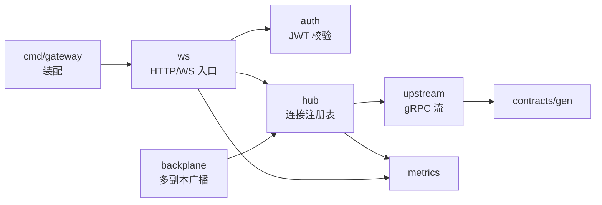

# gateway/internal 架构

> 网关只做「长连接」:接 WS、验票、维护连接表、把上行帧转成 gRPC、把下行帧投递给正确的连接。
> **不做业务、不连数据库**。当前分包已经符合该职责,本文件用于固化规则,防止后续长歪。

## 0. 范式定位

网关是 **管道-过滤器(Pipes and Filters)+ 连接注册表** 的组合,不是分层业务架构:

- **管道-过滤器**:每个包只做一件事,数据在包之间单向流动(`ws → hub → upstream`),便于单独测。
- **注册表(Registry)**:`hub` 持有 userId↔conn 的映射,是所有下发路径的唯一入口(类似 actor 的"信箱",但无独立 actor 调度)。
- **背压**:每连接有界发送队列,满了断开,而不是无限缓冲——这是网关类服务的核心约束。

对照 `biz`(用例 + 仓储的分层):**网关没有领域层与数据层**,所以不要照搬 repo/service 分层,否则会出现空转的转发层。

## 1. 分层与依赖(实测无环)

| 包 | 职责 | 不该做 |
|---|---|---|
| `ws` | 握手、鉴权入口、读写循环、心跳/超时、限流 | 解析业务语义、直连 DB |
| `auth` | 只验 JWT(签名/过期),不查库 | 签发 token |
| `hub` | 连接注册表:userId↔conn、发送、关闭、统计 | 决定"消息该存哪" |
| `upstream` | gRPC 双向流:上行帧转发、下行帧分发、重连/多副本 | 解析 WS 协议细节 |
| `backplane` | 多副本间广播/通知(Redis 等) | 业务路由 |
| `presence` | 在线状态计算 | 落库(交给 biz) |
| `metrics` `config` | 横切 | 依赖业务包 |

## 2. 规则

1. **依赖单向**:`ws → auth/hub`、`hub → upstream`、`backplane → hub`;禁止反向 import,禁止循环。
2. **协议不跨界**:`ws` 只产出 `UplinkFrame` 这类结构;业务字段一律走 protobuf(`contracts/gen`),不要在网关自定义业务结构。
3. **连接生命周期只在 hub**:其他包要发消息给某用户,一律 `hub.Send(userID, frame)`,不要自己持有 conn。
4. **已知耦合(可接受但有代价)**:`hub` 直接依赖 `upstream` 的流写入,换传输要动 hub。若要解耦,给 `hub` 注入 `Sender` 接口即可。
5. **禁止阻塞**在读写循环里做重活;下发走 channel + 有界队列,满了就断开(背压)。
